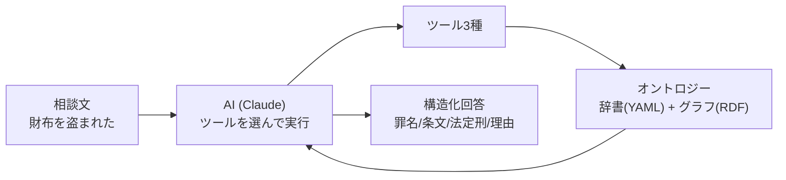
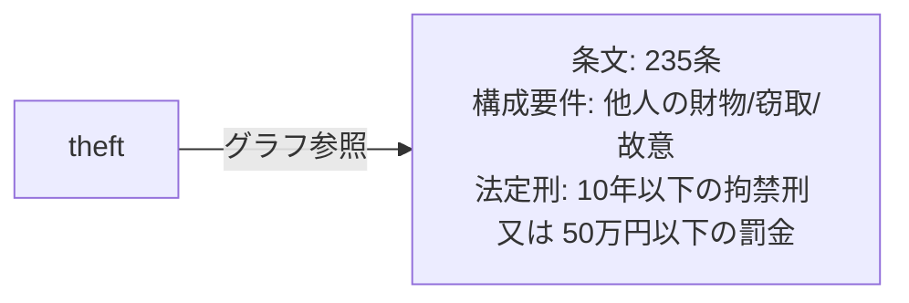
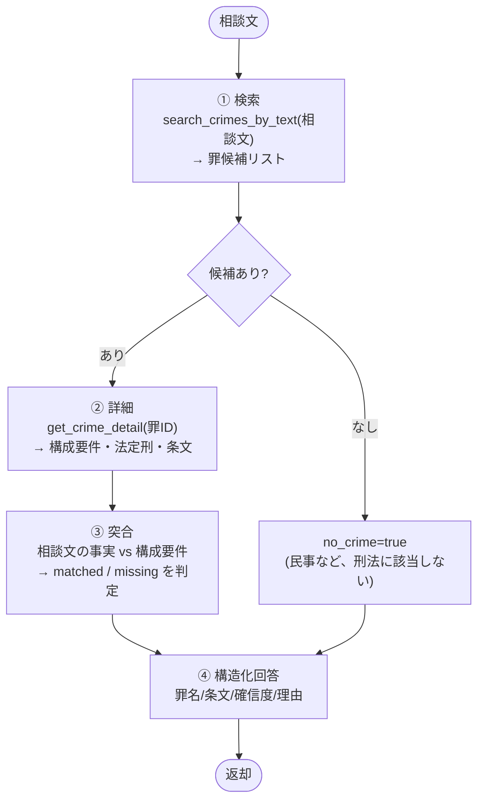
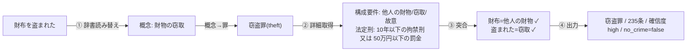
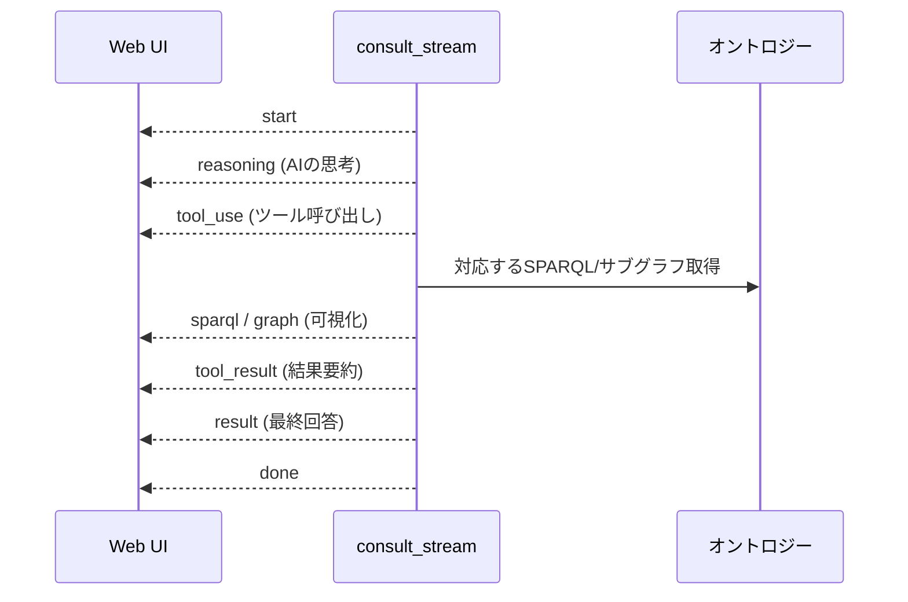

# Agent 内部実行プロセス可視化

刑法オントロジー法律相談エージェントが、相談文を受けてから回答を返すまでに
内部で何をしているかを、平易な粒度で説明する。

> ソース（`agent/`, `ontology/`）の静的解析に基づく。Bedrock 実行は含まない。

---

## 全体像

相談文を入れると、AI（Claude）がツールを使いながら「該当しうる罪」を調べて
構造化された回答を返す。AI 単体で判断せず、必ずオントロジー（辞書とグラフ）を
根拠にするのが特徴。

---

## ツール3種（AIが使う道具）

AIが相談処理で呼ぶ3つのツール（`agent/src/criminal_agent/tools.py`）。
`SYSTEM_PROMPT` の手順で呼び出しが指定されているのは `search_crimes_by_text` と
`get_crime_detail`。`list_crime_categories` は手順に記載が無く、呼ぶかどうかは AI の判断。

| ツール | 入力 | 出力 | 参照先 | 手順での指定 |
|---|---|---|---|---|
| `search_crimes_by_text` | 相談文 | 罪候補リスト（根拠語付き） | 辞書 + グラフ | 手順2 |
| `get_crime_detail` | 罪ID | 構成要件・法定刑・条文 | グラフ | 手順3 |
| `list_crime_categories` | なし | カテゴリ一覧 | グラフ（SPARQL） | なし |

### 辞書 `semantics.yaml` と照合方式

`search_crimes_by_text` が使う辞書。日常語（素人の言葉）を
法律概念へ、そして罪IDへ橋渡しする。

- 照合方式は **部分一致**（相談文に辞書の語が文字列として含まれるか）。
- 長い語ほど高スコア（`1.0 + 文字数 × 0.1`）。短い語の誤マッチを抑えるため。
- 辞書に無い言い回し（例「パクられた」）は拾えない＝何も返らない。

### `search_crimes_by_text`

相談文 → 概念 → 罪候補の2段階で解決し、罪候補リストを返す。該当なしは空リスト。

- 複数の概念が同じ罪を指す場合は1候補に集約し、概念スコアを合算。スコア降順。
- 罪名・条番号・カテゴリ・法定刑の概要はグラフから付与。
- `matched_surface`: 相談文中で辞書にマッチした語（例「盗まれた」「財布を盗まれた」）。
  候補が出た根拠。重複なし。AI は理由の説明にこれを使う（`SYSTEM_PROMPT` 手順2）。
- 出力: `crime_id` / `label` / `article` / `category` / `penalties` / `score` / `via_concepts`（経由した概念ID）/ `matched_surface`（根拠語）。

### `get_crime_detail`

罪IDを受け取り、グラフから罪の中身を取り出す。存在しないIDは `{"error": ...}`。

- 構成要件は要素ごとに種別・説明・キーワードを持つ。③突合の材料になる。
- 出力: `crime_id` / `label` / `article` / `category` / `legal_interest`（保護法益）/ `statute_text`（条文）/ `elements`（構成要件）/ `penalties`（法定刑）/ `related_to`（関連罪）。

### `list_crime_categories`

収録している罪のカテゴリ（保護法益による分類）を SPARQL で一覧化する。入力なし。

- 推論（owlrl）で上位カテゴリにも所属が付くため、件数は2種類。
  - `count`: 推論込みの所属罪数（下位カテゴリの罪も含む）。
  - `direct_count`: 直接そのカテゴリに収録した罪数。
- `leaf`: 下位カテゴリを持たない最下層なら true。
- 出力: `id` / `label` / `count` / `direct_count` / `leaf`。

---

## 処理の流れ（ReAct ループ）

AI は `SYSTEM_PROMPT` の手順に従い、ツールを順に呼ぶ。

| ステップ | 入力 | 出力 | やること |
|---|---|---|---|
| ① 検索 | 相談文 | 罪候補 | 辞書で読み替えて候補を出す |
| ② 詳細 | 罪ID | 構成要件等 | 候補の中身をグラフから取る |
| ③ 突合 | 事実＋構成要件 | matched/missing | 要件を満たすか判定 |
| ④ 出力 | 判定結果 | 構造化JSON | 確信度付きで回答 |

---

## 具体例

### ケースA: 「財布を盗まれた」→ 窃盗罪

- ① 「盗まれた」「財布を盗まれた」が辞書にあり → 概念「財物の窃取」→ `theft`。
- ② `theft` の構成要件・法定刑・条文を取得。
- ③ 事実が構成要件を満たす。
- ④ 窃盗罪・235条・確信度high で回答。

### ケースB: 「貸した金が返ってこない」→ 刑法上該当なし

- ① 辞書に該当語が無く候補が空（横領の「預けた金が返らない」とは別物）。
- ② 以降は実行されない。
- ④ 「刑法上は該当しない、民事の問題」と回答。

---

## 辞書とグラフの使い分け

同じオントロジーだが用途が分かれる。

| | 検索系（辞書） | グラフ系（RDF） |
|---|---|---|
| 実体 | `semantics.yaml` をメモリに展開 | Turtle + owlrl 推論 |
| 使う場面 | ① 検索（日常語→罪の読み替え） | ② 詳細取得・可視化 |
| 方式 | 部分一致 | SPARQL |

- ① の読み替えは辞書（高速・決定的だが辞書外は拾えない）。
- ② の構成要件取得や、Web UI 向けの SPARQL/サブグラフ可視化はグラフ。

---

## ストリーミング（SSE・Web UI用）

`/consult/stream` は上記の流れを逐次配信し、AIの思考・ツール呼び出し・
実行SPARQL・取得グラフを可視化する。相談結果とは別に横付けするので、
可視化が失敗しても回答自体は止まらない。

| イベント | 内容 |
|---|---|
| `start` / `done` / `error` | 開始 / 完了 / エラー |
| `reasoning` | AIの思考 |
| `tool_use` | ツール呼び出し |
| `sparql` / `graph` | 実行SPARQL / 取得サブグラフ（可視化） |
| `tool_result` | ツール結果の要約 |
| `result` | 最終構造化回答 |

---

## まとめ

- ツールは3種。手順で指定されるのは `search_crimes_by_text`（罪候補＋根拠語）と `get_crime_detail`（構成要件等）。
  `list_crime_categories`（分類一覧）は AI が必要に応じて呼ぶ。
- 相談文の読み替えは辞書の部分一致なので、辞書に無い語は拾えない。
- 候補が出たら構成要件をグラフから取り、事実と突合して確信度付きで回答。
- 該当なしは `no_crime=true`（民事など）。
